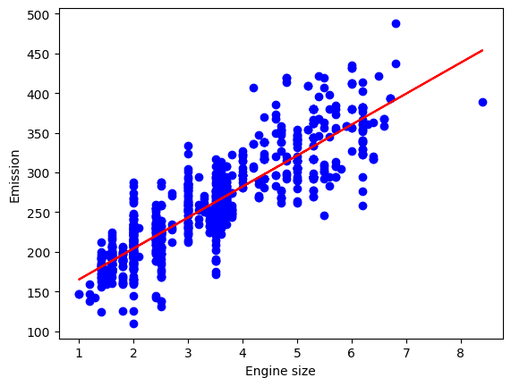

# CO2 Emissions Regression

**Question:** How well can engine size and fuel consumption predict a vehicle's CO2 emissions?

**Data:** FuelConsumptionCo2 dataset: about 1,067 light-duty vehicles with engine size, cylinders, fuel consumption and CO2 emissions.

## Approach

- EDA: histograms and scatter plots per feature
- Simple linear regression (engine size → CO2)
- Multiple linear regression on standardized features (engine size + combined MPG), with the coefficients converted back to the original units
- Evaluation with MAE, MSE, RMSE and R²; 3D regression-plane visualization

## Results

| Model | MAE | RMSE | R² |
|---|---|---|---|
| Simple linear (engine size) | 24.10 g/km | 31.40 g/km | 0.76 |

## Key findings

- Every extra litre of engine size adds about 39 g/km of CO2.
- Fuel consumption vs CO2 splits into parallel linear tracks, which points to fuel type as a hidden variable worth adding.
- In the multiple model, higher MPG lowers emissions (standardized coefficient −37.4) while engine size raises them (+25.3).

## Stack

pandas, NumPy, scikit-learn, Matplotlib

## Run it

Open [`analysis.ipynb`](analysis.ipynb) in Jupyter or VS Code. The data downloads from its public URL in the first cells.
