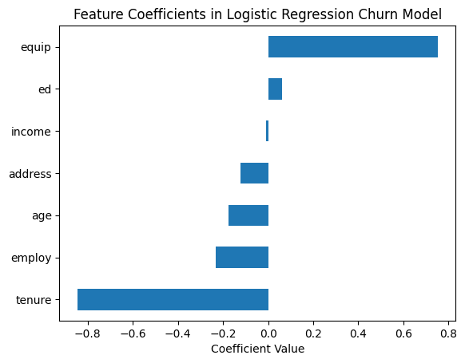

# Customer Churn Prediction (Logistic Regression)

**Question:** Which customers are likely to leave a telecom provider, and what drives that risk?

**Data:** ChurnData (IBM): 200 telecom customers with tenure, age, address, income, education, employment, equipment rental and churn.

## Approach

- Feature selection and standardization (StandardScaler)
- Logistic regression, 80/20 train-test split
- Probability predictions evaluated with log loss
- Interpretation of standardized coefficients as changes in log-odds

## Results

| Metric | Value |
|---|---|
| Log loss (test) | 0.63 |

## Key findings

- **Tenure is the strongest factor and it lowers churn** (coef ≈ −0.85): one standard deviation more tenure cuts the odds of churning by about 57%.
- **Equipment rental raises churn the most** (coef ≈ +0.75, about 2.1× the odds).
- Employment length, age and years at the same address lower churn moderately. Income and education have almost no effect.
- Business takeaway: focus retention on new customers who rent equipment.

## Stack

pandas, NumPy, scikit-learn, Matplotlib

## Run it

Open [`analysis.ipynb`](analysis.ipynb) in Jupyter or VS Code. The data downloads from its public URL in the first cells.
