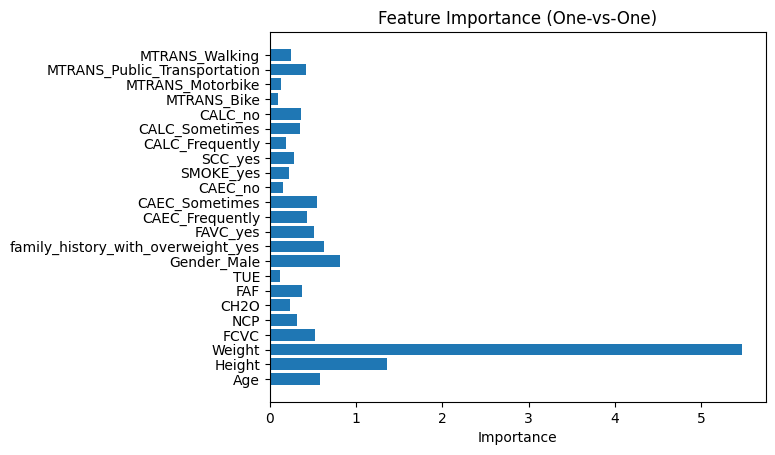

# Obesity Level Classification (Multiclass)

**Question:** Can eating habits and physical condition predict a person's obesity level, and which multiclass strategy works better?

**Data:** UCI *Estimation of Obesity Levels* dataset: 2,111 records, 16 features, 7 balanced classes (about 77% generated synthetically with SMOTE).

## Approach

- Standardization of continuous features and one-hot encoding of categorical ones
- Stratified train-test split
- Logistic regression with One-vs-All vs One-vs-One (OneVsOneClassifier)
- Sensitivity to test size and feature importance (mean absolute coefficient)
- A reusable end-to-end pipeline function

## Results

| Strategy | Test accuracy |
|---|---|
| One-vs-All | 87.9% |
| **One-vs-One** | **92.2%** |

## Key findings

- One-vs-One beats One-vs-All by about 4 points.
- Weight (≈ 5.5) and Height (≈ 1.35) dominate the model. The target is derived from BMI, so this is target leakage. A model without them would show which habits really matter.
- Gender, family history of overweight, age, eating between meals and high-calorie food are the strongest non-anthropometric predictors.

## Stack

pandas, NumPy, scikit-learn, Matplotlib, Seaborn

## Run it

Open [`analysis.ipynb`](analysis.ipynb) in Jupyter or VS Code. The data downloads from its public URL in the first cells.
