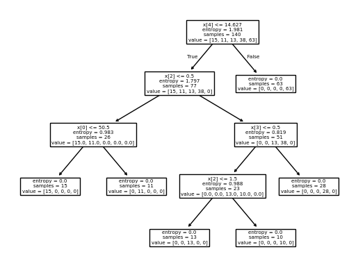

# Drug Prescription Decision Tree

**Question:** Which of five drugs fits a new patient, given their clinical profile?

**Data:** drug200 (IBM): 200 patients with age, sex, blood pressure, cholesterol and sodium-to-potassium ratio; 5 drug classes (imbalanced: drugY ≈ 45%).

## Approach

- Label encoding of categorical features
- Class-distribution and correlation analysis
- Decision tree classifier (entropy criterion); tree visualization
- Effect of maximum depth on accuracy

## Results

| Max depth | Test accuracy |
|---|---|
| 3 | 81.7% |
| **4** | **98.3%** |

## Key findings

- The root split is the Na-to-K ratio (≤ 14.63). Above that threshold every patient gets drugY, a perfectly pure leaf.
- Blood pressure, age and cholesterol then separate the remaining four drugs.
- Depth 4 is needed: depth 3 loses about 17 points of accuracy.

## Stack

pandas, NumPy, scikit-learn, Matplotlib

## Run it

Open [`analysis.ipynb`](analysis.ipynb) in Jupyter or VS Code. The data downloads from its public URL in the first cells.
