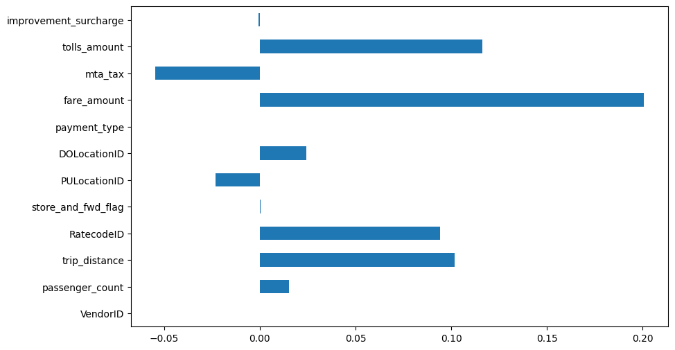

# NYC Taxi Tip Prediction (Regression Tree)

**Question:** Can trip characteristics predict how much a New York yellow-taxi passenger tips?

**Data:** NYC yellow-taxi trip records (IBM subset): distance, fare, tolls, times, locations and tip amount.

## Approach

- Correlation of every feature with tip amount
- Decision tree regressor (squared error) with a 70/30 split
- Evaluation with MSE and R²

## Results

| Metric | Value |
|---|---|
| MSE | 24.56 |
| R² | 0.03 |

## Key findings

- Trip features explain almost none of the variance in tips (R² ≈ 0.03).
- Tipping depends mostly on factors not in the data, such as payment type (cash tips are not recorded) and passenger behaviour. This is a useful negative result: more modeling won't fix missing signal.

## Stack

pandas, NumPy, scikit-learn, Matplotlib

## Run it

Open [`analysis.ipynb`](analysis.ipynb) in Jupyter or VS Code. The data downloads from its public URL in the first cells.
