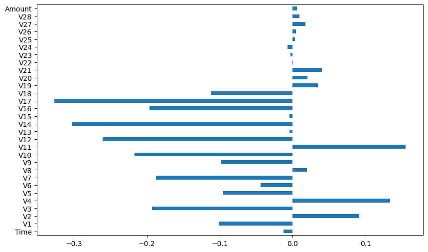

# Credit Card Fraud Detection (Decision Tree vs SVM)

**Question:** How well can fraudulent card transactions be detected when they are only about 0.17% of the data?

**Data:** European credit card transactions (IBM subset of the Kaggle dataset): 28 anonymized PCA components (V1–V28), Time, Amount and Class.

## Approach

- Correlation of each feature with the fraud label
- Standardization and balanced sample weights for the severe class imbalance
- Decision tree (max depth 4) vs linear SVM (hinge loss, balanced class weights)
- ROC-AUC evaluation instead of accuracy

## Results

| Model | ROC-AUC |
|---|---|
| Decision tree | 0.939 |
| **Linear SVM** | **0.986** |

## Key findings

- V17, V14, V12, V10, V16 and V3 have the strongest (negative) correlation with fraud. Amount and Time barely relate to it.
- The linear SVM ranks fraud better than the decision tree (ROC-AUC 0.986 vs 0.939).
- Accuracy is misleading here: always predicting "not fraud" is already 99.8% accurate, so ROC-AUC is used.

## Stack

pandas, NumPy, scikit-learn, Matplotlib

## Run it

Open [`analysis.ipynb`](analysis.ipynb) in Jupyter or VS Code. The data downloads from its public URL in the first cells.
