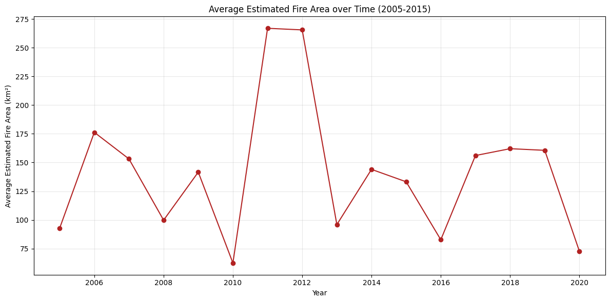

# Australia Wildfire Analysis and Dashboard

**Question:** How have wildfires in Australia changed over time and across regions?

**Data:** Historical wildfire satellite records (IBM): 26,406 rows across 7 regions (2005–2020): estimated fire area, brightness, radiative power, confidence and pixel counts.

## Approach

- Time-series line charts by year and month (pandas, Matplotlib)
- Regional comparisons with Seaborn bar plots, histograms and pie charts
- Scatter analysis of fire radiative power vs confidence
- Folium map of the seven regions
- Interactive Dash + Plotly dashboard (region and year selectors)

## Key findings

- Average estimated fire area peaked in 2011–2012 (about 265 km² per record), about twice the typical level.
- Fire activity differs strongly between regions, and so does the share of vegetation-fire pixels each region contributes.
- The dashboard lets non-technical users explore monthly fire area and vegetation-fire counts by region and year.

## Stack

pandas, Matplotlib, Seaborn, Folium, Plotly, Dash

## Run it

Open [`analysis.ipynb`](analysis.ipynb) in Jupyter or VS Code. The data downloads from its public URL in the first cells.
