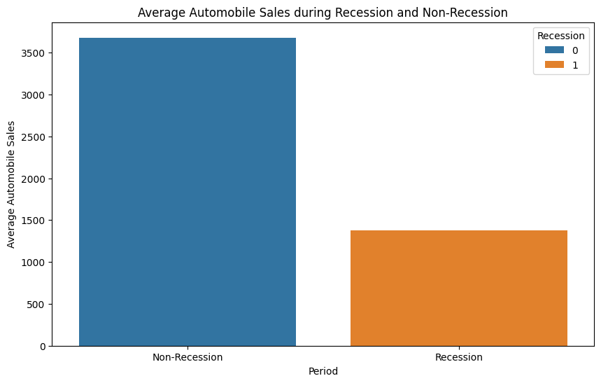

# Automobile Sales During Recessions

**Question:** How do recessions affect automobile sales, and how should a company adjust its strategy?

**Data:** Historical automobile sales (IBM, 1980–2023): sales, vehicle type, GDP, unemployment, consumer confidence, advertising spend and seasonality.

## Approach

- Line, bar, bubble and scatter plots comparing recession and non-recession periods
- Subplots of GDP and sales by vehicle type
- Pie charts of advertising spend by period and vehicle type
- Interactive Dash dashboard with yearly and recession reports (also a standalone script: `04_visualization/Automobile_Sales_Statistics_Dashboard.py`)

## Key findings

- Average sales fall from about 3,600 to about 1,300 units during recessions, a drop of more than half.
- Executive and sports cars suffer the largest drops (from about 3,300–3,400 to under 1,000 units). SuperMini cars hold up best and become the top seller during recessions.
- 82.7% of advertising spend happens outside recessions, so companies cut marketing exactly when demand falls.
- December is the seasonal peak, while consumer confidence alone shows no linear relationship with sales.

## Stack

pandas, Matplotlib, Seaborn, Plotly, Dash

## Run it

Open [`analysis.ipynb`](analysis.ipynb) in Jupyter or VS Code. The data downloads from its public URL in the first cells.
