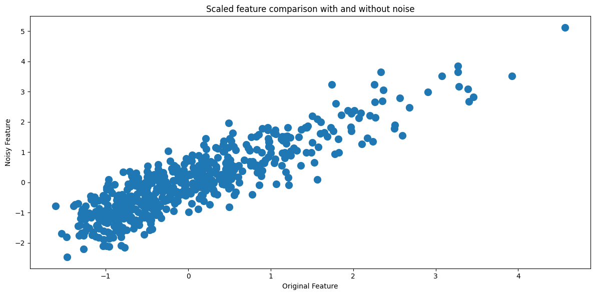
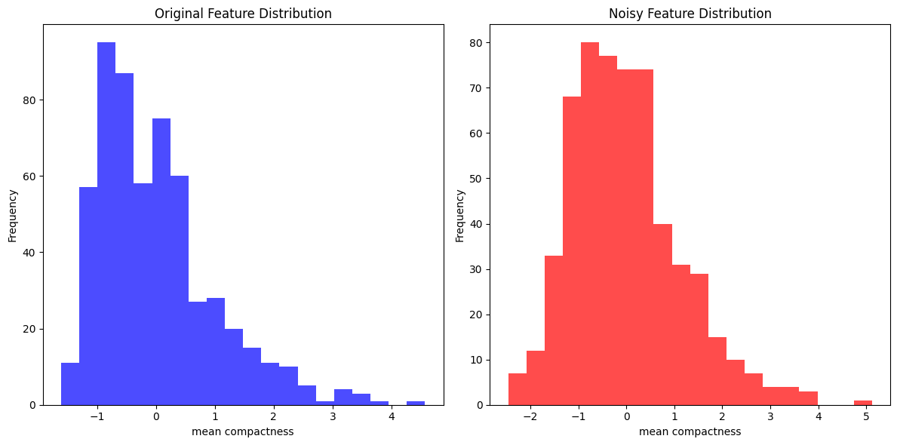

# Impact of Noise on Data Quality (Breast Cancer Wisconsin)

**Question:** How does random measurement error change a feature, and how much of its information survives?

**Data:** Breast Cancer Wisconsin (Diagnostic) dataset from scikit-learn: 569 tumours, 30 numeric features, malignant / benign labels.

## Approach

- Standardize all 30 features (StandardScaler)
- Add Gaussian noise with `noise_factor = 0.5`, i.e. half of each feature's standard deviation, with a fixed seed for reproducibility
- Compare one feature (`mean compactness`) before and after the noise with:
  - histograms of both distributions
  - a sample-by-sample line plot
  - an original-vs-noisy scatter plot

## Results

| Metric (`mean compactness`) | Original | Noisy |
|---|---|---|
| Minimum | −1.61 | −2.46 |
| Maximum | 4.57 | 5.12 |
| Correlation with original | — | **0.888** |

Across all 30 features, the average correlation between original and noisy values is **0.895**. That matches the theoretical value of 1/√(1 + 0.5²) ≈ 0.894.

## Key findings

- **The centre doesn't move.** Gaussian noise has mean 0, so the distribution stays centred near 0 and keeps its right skew.
- **The variance grows and the detail disappears.** The range widens on both sides, and the irregular peaks of the original feature smooth into a bell shape.
- **The noise creates artificial outliers.** It adds a new left tail of values below anything in the real data (down to −2.46), and it moves a few samples by around 3 noise standard deviations.
- **Most of the signal survives.** A correlation of about 0.89 means roughly 20% of each noisy feature's variance is noise. A model can still learn the main pattern, but borderline samples are the ones most likely to be misclassified.

## Stack

NumPy, pandas, scikit-learn, Matplotlib

## Run it

Open [`analysis.ipynb`](analysis.ipynb) in Jupyter or VS Code. The dataset ships with scikit-learn, so it needs no download.
