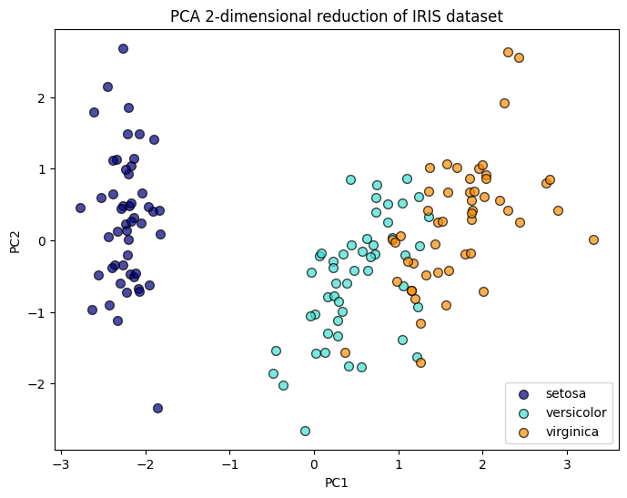

# Principal Component Analysis (PCA)

**Question:** How much of the information in correlated features can a few principal components keep?

**Data:**
- 200 points from a bivariate normal distribution (covariance `[[3, 2], [2, 2]]`)
- The Iris dataset: 150 flowers, 4 measurements, 3 species

## Approach

- Fit PCA on the bivariate data, then project the points onto PC1 and PC2 and plot the projections
- Standardize Iris, reduce it to 2 components and plot the species in the PC1–PC2 plane
- Plot the explained variance per component and the cumulative variance

## Results

| Data | PC1 | PC2 | Kept with 2 components |
|---|---|---|---|
| Bivariate normal | 91.1% | 8.9% | 100% |
| Iris (standardized, 4 features) | ~73% | ~23% | **95.8%** |

## Key findings

- In the bivariate data, PC1 points along the long axis of the ellipse, about 38° from the X1 axis (direction ≈ [0.78, 0.62]). One component keeps 91% of the variance, so the two features are largely redundant.
- For Iris, 2 components keep 95.8% of the variance of the 4 measurements. The elbow in the explained-variance plot is at PC2.
- On PC1 alone, setosa is fully separated from the other species. Versicolor and virginica overlap slightly, which is where a classifier will make its mistakes.

## Stack

NumPy, scikit-learn, Matplotlib

## Run it

Open [`analysis.ipynb`](analysis.ipynb). The datasets are generated in the notebook or ship with scikit-learn.
