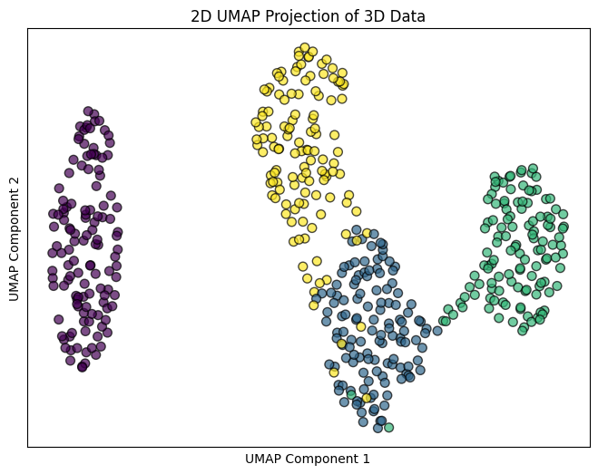
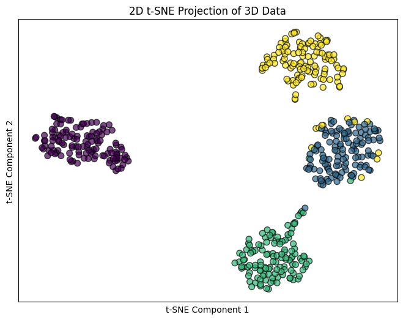

# t-SNE vs UMAP on 3-D Clusters

**Question:** When 3-D data is reduced to 2-D, what do t-SNE and UMAP keep, and what do they distort?

**Data:** 500 synthetic points in 4 clusters in 3-D, built with `make_blobs`. The clusters have very different spreads (standard deviations 1, 1, 2 and 3.5).

## Approach

- Interactive 3-D Plotly scatter of the original clusters
- Standardize the data, then reduce it to 2-D with **t-SNE** (perplexity 30) and **UMAP** (`min_dist=0.5`)
- Compare both projections with the 3-D ground truth

## Key findings

| | t-SNE | UMAP |
|---|---|---|
| Finds the 4 groups | Yes, as 4 clean islands | Yes |
| Distances between clusters | Exaggerated: every cluster looks equally far apart | More realistic: one cluster isolated, three neighbours |
| Differences in spread | Lost: every cluster looks the same size | Partly kept |
| Overlapping points | Hidden inside clean islands | Visible as bridges and mixing |

- **t-SNE** is very good at showing that groups exist, but cluster sizes and the distances between clusters in its plots are not meaningful.
- **UMAP** gives a more honest picture of this data. It shows which clusters really overlap in 3-D and which one is isolated.

## Stack

scikit-learn (t-SNE), umap-learn, Plotly, Matplotlib

## Run it

Open [`analysis.ipynb`](analysis.ipynb). It needs `umap-learn` (`pip install umap-learn`).
