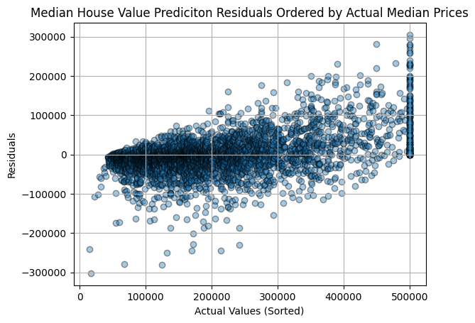
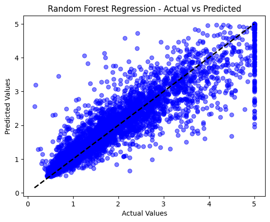

# California Housing Prices (Random Forest Regression)

**Question:** How well can a Random Forest predict the median house value of a California district, and where does it fail?

**Data:** California Housing (scikit-learn): 20,640 districts, 8 features (income, house age, rooms, population, location), with a target in units of $100,000. Split 80/20.

## Approach

- Target analysis: skewness and the $500,000 cap
- `RandomForestRegressor` with 100 trees
- Evaluation with MAE, MSE, RMSE and R²
- Diagnostics: actual vs predicted, histogram of residuals, residuals ordered by actual price

## Results

| Metric | Value | In dollars |
|---|---|---|
| MAE | 0.3277 | ≈ $32,800 |
| RMSE | 0.5060 | ≈ $50,600 |
| **R²** | **0.8046** | — |
| Mean residual | — | −$1,250 (no overall bias) |

## Key findings

- **The target is skewed** (skewness 0.98) and **capped at $500,001**. Every more expensive district is recorded at the cap, so its true value is unknown.
- **The model explains about 80% of the variance.** It's reliable for typical districts ($50k–$350k).
- **It pulls extreme values toward the middle:** cheap districts are overestimated and expensive ones underestimated. Random Forest averages training values, so it can't predict beyond the range it saw in training.
- **The error grows with price.** For capped districts, every residual is positive, by up to about $300k. The cap is the main source of the large errors and of the gap between RMSE and MAE.
- **Next steps:** handle the capped rows, model `log(price)`, and compare with gradient boosting.

## Stack

NumPy, pandas, SciPy, scikit-learn, Matplotlib

## Run it

Open [`analysis.ipynb`](analysis.ipynb). The dataset downloads through `fetch_california_housing()`.
