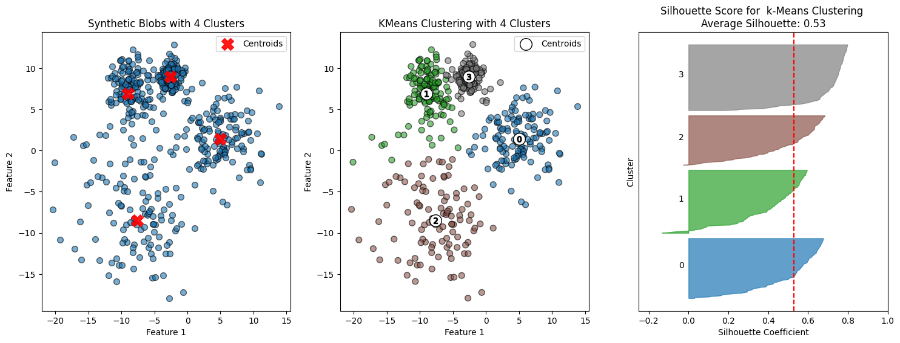
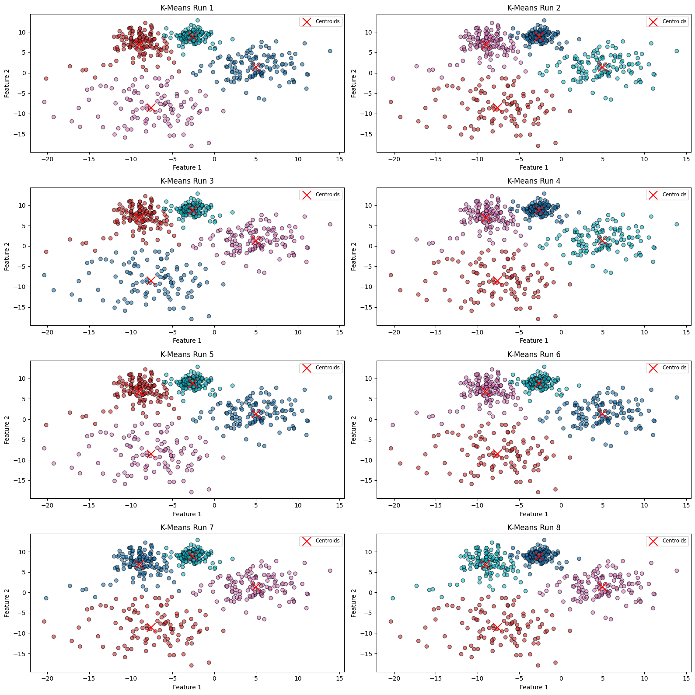

# K-Means Cluster Evaluation (Silhouette and Stability)

**Question:** How good is a K-Means clustering, and does the result depend on the random initialization?

**Data:** 500 synthetic points in 4 clusters with unequal spreads (standard deviations 1, 3, 5 and 2), built with `make_blobs`.

## Approach

- A reusable `evaluate_clustering` function that plots silhouette analysis and reports the Davies-Bouldin index
- K-Means with k = 4, compared with the true blobs
- A stability check: 8 runs with different random initializations, comparing assignments and inertia

## Results

| Metric | Value |
|---|---|
| Average silhouette | **0.53** |
| Inertia, all 8 runs | **7,633.51** (identical) |

## Key findings

- **K-Means placed the 4 centroids almost exactly** on the true cluster centres.
- **Its boundaries fail for the diffuse cluster.** It assigns points to the nearest centroid, so the edge of the widest cluster is given to its neighbours. One cluster has negative silhouette values, which marks misassigned boundary points.
- **An average silhouette of 0.53** means a reasonable structure with some overlap.
- **The result is fully stable:** all 8 initializations give the same grouping and the same inertia. Only the label numbers change (label switching). The boundary error is therefore a limitation of K-Means itself, not bad luck. Gaussian mixtures or DBSCAN would handle the unequal spreads better.

## Stack

NumPy, scikit-learn, Matplotlib

## Run it

Open [`analysis.ipynb`](analysis.ipynb). All data is generated in the notebook.
