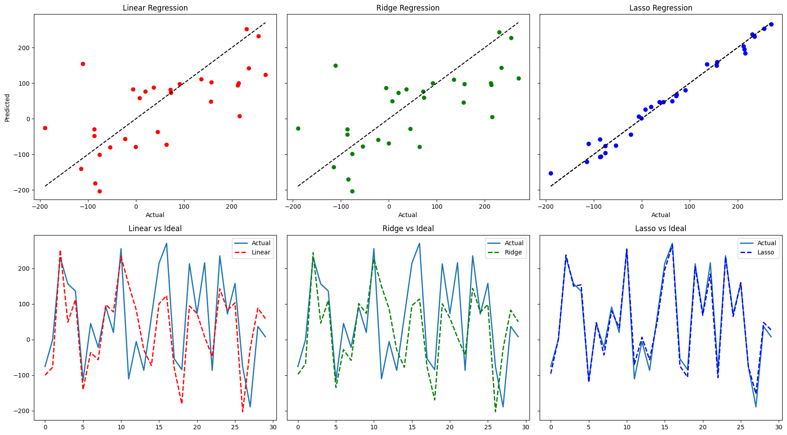
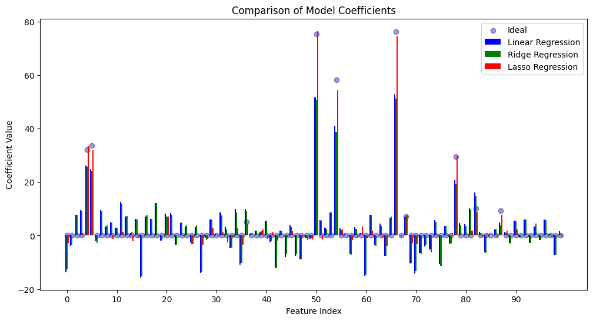

# Regularization: Linear vs Ridge vs Lasso

**Question:** When do Ridge and Lasso actually improve on ordinary linear regression?

**Data (synthetic):**
1. **Outlier experiment:** 1,000 points from y = 4 + 3X + noise, plus 5 extreme outliers at high X.
2. **Sparse experiment:** 100 samples and 100 features, of which only 10 are informative (`make_regression`). Split 70/30.

## Approach

- Fit linear regression, Ridge (`alpha=1`) and Lasso on both datasets (Lasso `alpha=0.2` for the outliers, `0.1` for the sparse problem)
- Compare fitted lines, actual vs predicted values, and the learned coefficients against the true ones
- Report explained variance, R², MAE, MSE and RMSE

## Results

**Outliers** (fitted with the outliers, scored against the clean data):

| Model | R² | RMSE |
|---|---|---|
| Linear | 0.636 | 1.19 |
| Ridge | 0.638 | 1.19 |
| Lasso | **0.700** | **1.08** |

**Sparse, 100 features** (test set):

| Model | R² | RMSE |
|---|---|---|
| Linear | 0.402 | 99.2 |
| Ridge | 0.408 | 98.7 |
| **Lasso** | **0.982** | **17.5** |

## Key findings

- **5 outliers out of 1,000 tilt linear regression and Ridge.** The slope rises from 3 to about 3.8. Ridge is indistinguishable from linear regression, so the L2 penalty doesn't protect against outliers. Lasso does better here only because its shrinkage happens to offset the upward pull; the proper fixes are removing the outliers or using robust regression (Huber, RANSAC).
- **In the sparse problem, Lasso dominates (R² 0.98 vs about 0.40).** It sets the coefficients of almost all the 90 irrelevant features to zero and recovers the 10 real ones close to their true values. Linear regression and Ridge spread weight over all 100 features and underestimate the real effects by about a third.
- **Takeaway:** Lasso is the right tool when you have many features and only a few of them matter, and it also tells you which features those are. Ridge needs a well-tuned `alpha` and suits many correlated features that all contribute.

## Stack

NumPy, pandas, scikit-learn, Matplotlib

## Run it

Open [`analysis.ipynb`](analysis.ipynb). All data is generated in the notebook.
