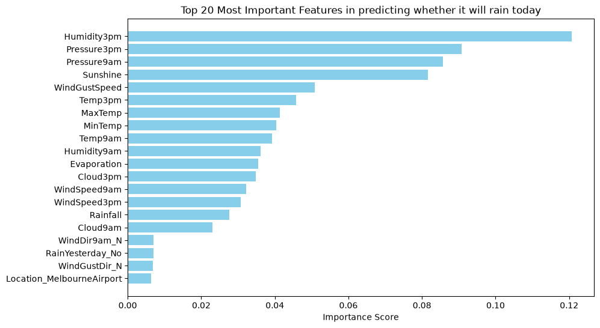
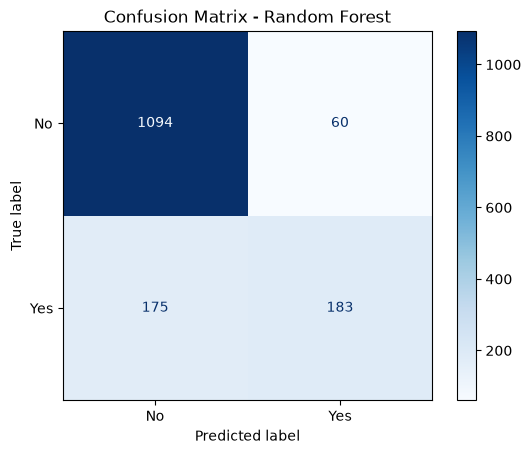

# Rainfall Prediction Classifier

**Question:** Can daily weather observations predict rain in the Melbourne area, and which model does it better?

**Data:** Australian Bureau of Meteorology daily observations (`weatherAUS`), 2008–2017. 145,460 rows, 56,420 complete, and 7,557 for Melbourne, Melbourne Airport and Watsonia.

## Approach

- Rename the columns so the target is `RainToday` and the previous day's rain is a feature (`RainYesterday`)
- Engineer a Southern Hemisphere `Season` feature from the date
- `ColumnTransformer` pipeline: `StandardScaler` for numeric features, `OneHotEncoder` for categorical ones
- Random Forest and Logistic Regression, tuned with `GridSearchCV` and `StratifiedKFold`

## Results

Baseline: always predicting "no rain" gives 76.3% accuracy.

| Metric (test set) | Random Forest | Logistic Regression |
|---|---|---|
| Accuracy | **0.84** | 0.83 |
| Precision (rain) | **0.75** | 0.69 |
| Recall (rain) | 0.51 | 0.51 |
| F1 (rain) | **0.61** | 0.59 |
| False alarms | **60** | 83 |

## Key findings

- It rains on 23.7% of days, about 87 days a year, so the classes are imbalanced (3.2 to 1).
- Both models beat the baseline, but both catch only about half of the rainy days.
- Random Forest is the better predictor: same recall, higher precision and 23 fewer false alarms.
- `Humidity3pm` is the most important feature (0.121), followed by `Pressure3pm` (0.091), `Pressure9am` (0.086) and `Sunshine` (0.082).
- **Limitation:** 3 pm readings are taken on the same day the rain falls, so a morning forecast wouldn't have them. Tuning on recall or F1 is the next step to catch more rainy days.

## Stack

pandas, scikit-learn, Matplotlib, Seaborn

## Run it

Open [`rainfall_prediction_classifier.ipynb`](rainfall_prediction_classifier.ipynb). The data downloads from its public URL.
