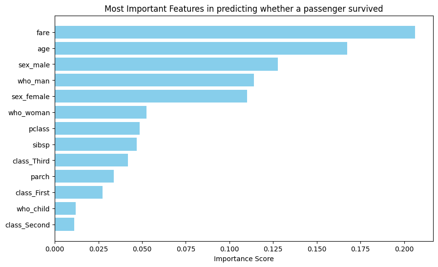
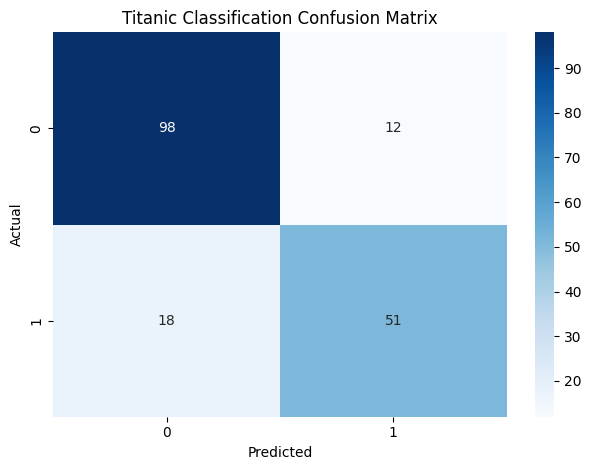

# Titanic Survival Classification

**Question:** Which passengers survived the Titanic, and does a more complex model predict that better?

**Data:** Seaborn's `titanic` dataset, 891 passengers, split 80/20 with stratification (179 in the test set).

## Approach

- Pipeline with median imputation and scaling for numeric features, and one-hot encoding for categorical ones
- Random Forest tuned with `GridSearchCV` and `StratifiedKFold`
- The same pipeline with Logistic Regression
- Confusion matrices, feature importances and coefficients

## Results

Baseline: always predicting "did not survive" gives 61.5% accuracy.

| Metric (test set) | Random Forest | Logistic Regression |
|---|---|---|
| Accuracy | **83.2%** | 82.7% |
| Precision (survived) | 0.81 | 0.81 |
| Recall (survived) | **0.74** | 0.72 |
| Missed survivors | 18 | 19 |

## Key findings

- The two models are effectively tied: they differ by one passenger out of 179, which is within random variation. The simpler Logistic Regression is a reasonable choice.
- Both identify deaths well (89%) but miss about 1 in 4 survivors.
- Sex-related columns add up to about 0.40 of the importance, roughly twice `fare`. Because the columns overlap, importance should be read by group: `sex` and `who` repeat each other, and so do `pclass` and `class`.
- Impurity-based importance tends to overrate continuous features like `fare` and `age`, so permutation importance would be a useful check.

## Stack

pandas, NumPy, scikit-learn, Matplotlib, Seaborn

## Run it

Open [`analysis.ipynb`](analysis.ipynb). The dataset loads through `sns.load_dataset('titanic')`.
