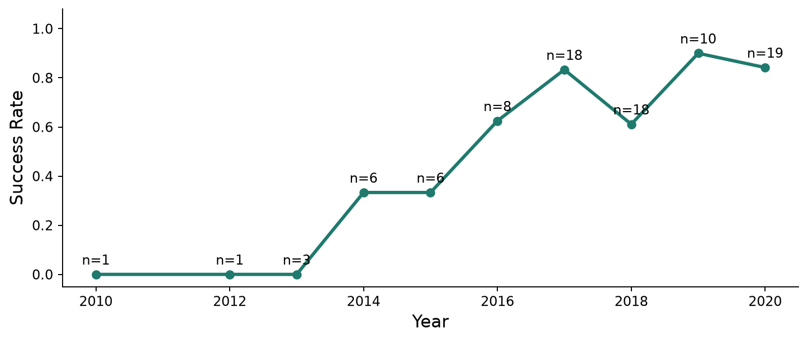

# SpaceX Falcon 9 Landing Prediction: Capstone

**Question:** Can public launch data predict whether a Falcon 9 first stage lands, and how far can that prediction be trusted?

**Data:** IBM Skills Network datasets (SpaceX API copy, SQL, geolocation and dashboard files) and a fixed revision of Wikipedia's Falcon 9 launch list.

## Files

| Step | File |
|---|---|
| API collection and wrangling | [`../19_spacex_data_collection_wrangling/analysis.ipynb`](../19_spacex_data_collection_wrangling/analysis.ipynb) |
| Web scraping | [`01_web_scraping.ipynb`](01_web_scraping.ipynb) |
| EDA with SQL | [`02_eda_sql.ipynb`](02_eda_sql.ipynb) |
| EDA with visualization | [`03_eda_visualization.ipynb`](03_eda_visualization.ipynb) |
| Folium maps | [`04_interactive_map.ipynb`](04_interactive_map.ipynb) |
| Plotly Dash app | [`spacex_dash_app.py`](spacex_dash_app.py) |
| Classification | [`05_classification.ipynb`](05_classification.ipynb) |

## Results

Baseline on the test set: always predicting a landing gives 66.7%.

| Model | CV accuracy | Test accuracy (18 flights) | Mean over 100 splits |
|---|---|---|---|
| Logistic Regression | 84.6% | 83.3% | 83.8% |
| SVM (sigmoid) | 84.8% | 83.3% | 84.7% |
| Decision Tree | 87.7% | 83.3% | 81.2% |
| KNN | 84.8% | 83.3% | 84.7% |

## Key findings

- Landing success rose from 0% through 2013 to 84% in 2020.
- All four models tie on the 18-flight test set, where one error moves accuracy by 5.6 points.
- Decision Tree has the best CV score but the lowest mean over 100 random splits.
- Flights above 8,000 kg landed more often (87% of 23) than lighter flights (60% of 67).
- Four orbits have only one flight, so their 0% and 100% rates aren't evidence.
- The stress test reuses parameters from the first grid search, so its scores may be slightly optimistic.

## Stack

pandas, scikit-learn, SQLite, BeautifulSoup, Matplotlib, Seaborn, Folium, Plotly Dash

## Run it

Run the notebooks in order. Start the dashboard with `python spacex_dash_app.py` and open `http://127.0.0.1:8050`.
